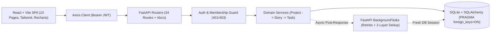
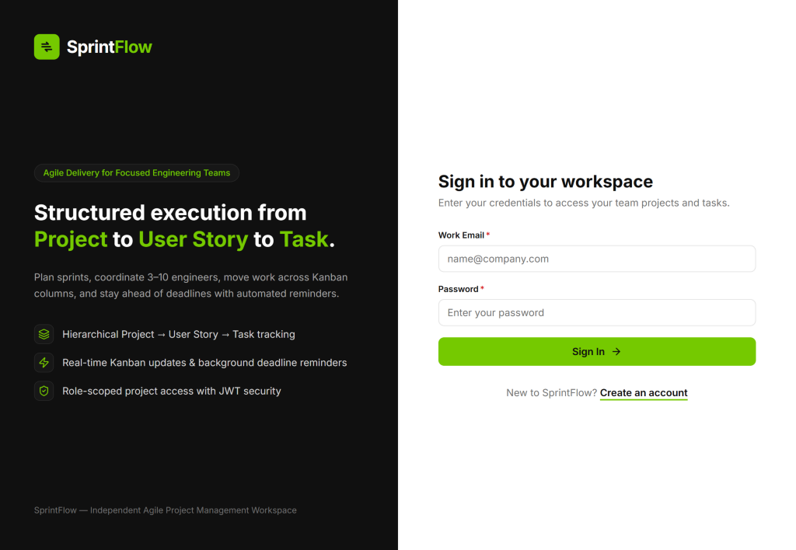
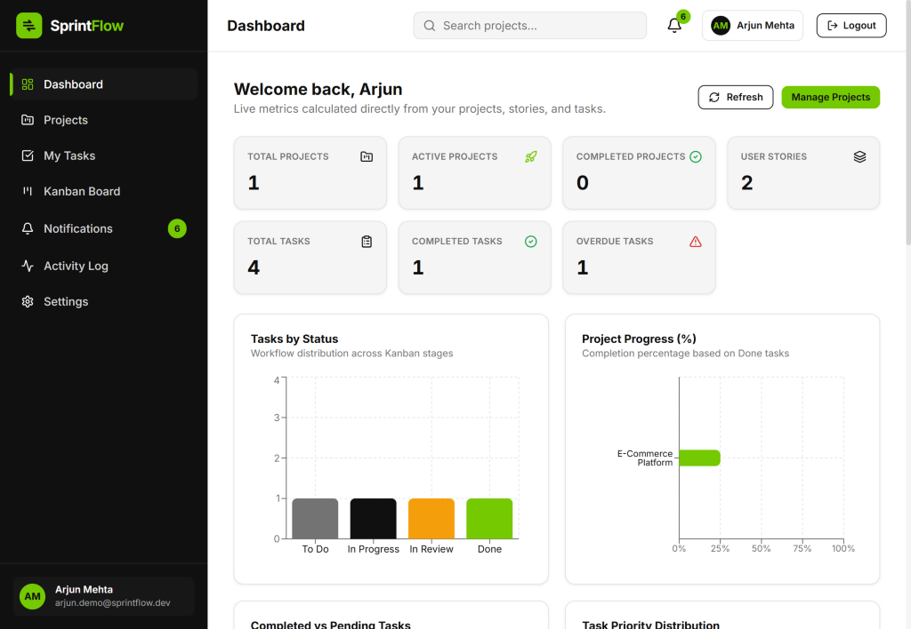
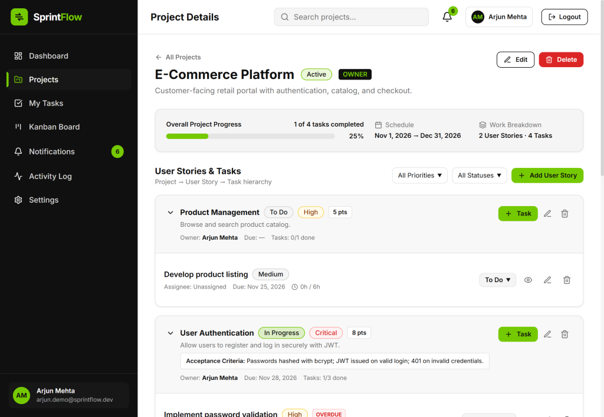
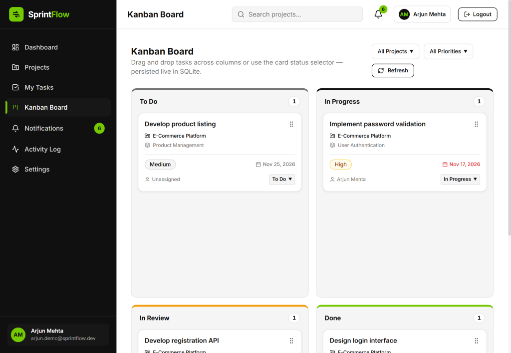
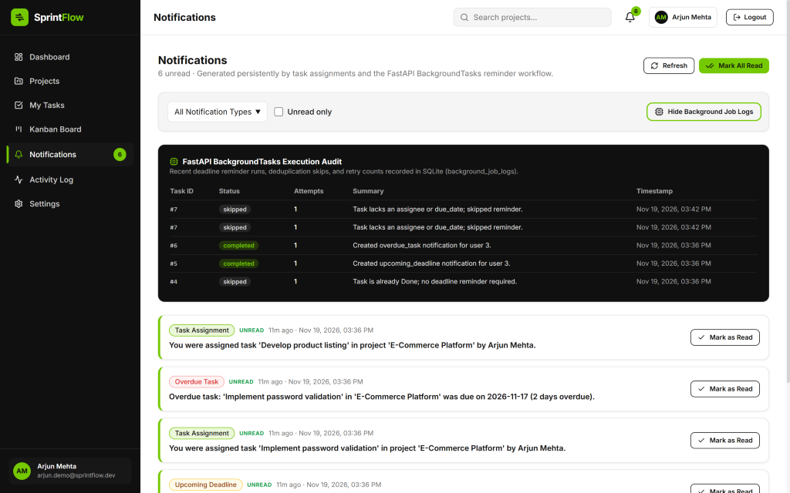
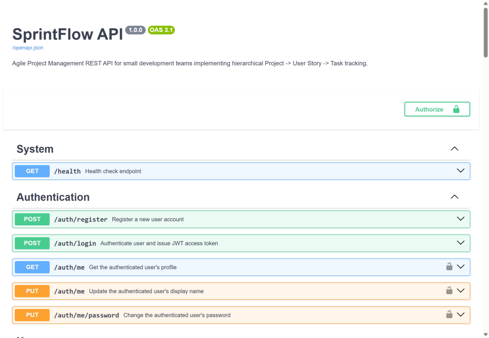

# SprintFlow — Agile Project Management Tool

> **KPIT Full-Stack Intern Assignment**  
> A complete, production-minded full-stack Agile Project Management web application built for small development teams of **3–10 users**, centered on hierarchical **`Project → User Story → Task`** tracking.

---

## Key Features

- **Hierarchical Work Tracking (`Project → User Story → Task`):** Full CRUD across projects, user stories (with acceptance criteria & story points), and tasks (with assignees, deadlines, estimated & actual hours), backed by strict SQLite foreign-key enforcement (`PRAGMA foreign_keys=ON`) and cascading deletion.
- **Authentication & Project-Scoped Authorization:** User registration and login with `bcrypt` password hashing (12 rounds), `PyJWT` Bearer JWT authentication, protected React routes, project owner vs. member permissions, and strict personal isolation for `/my-tasks` and `/notifications`.
- **Interactive Kanban Board:** Four columns (`To Do`, `In Progress`, `In Review`, `Done`) with HTML5 drag-and-drop + accessible status selectors, optimistic UI updates, SQLite persistence via `PATCH /tasks/{id}/status`, and automatic UI rollback on server errors.
- **Dynamic Dashboard & Analytics (Recharts):** 7 live KPI cards, 4 charts (Tasks by Status, Project Progress %, Completed vs Pending, Priority Distribution), and 6 real-time lists (Recent Projects, My Assigned Tasks, Upcoming Deadlines, Overdue Tasks, Recently Updated Tasks, Recent Activity) computed strictly from SQLite.
- **Asynchronous Background Deadline Workflow (`FastAPI BackgroundTasks`):** Non-blocking post-response deadline evaluation generating persistent `upcoming_deadline` and `overdue_task` notifications alongside `task_assignment` alerts, featuring two-layer duplicate prevention (`dedup_key` + DB `UNIQUE`), bounded retries with exponential backoff, graceful error isolation, and operational logging in `background_job_logs`.
- **Chronological Activity Log:** Tracks 11 project, user story, and task lifecycle events scoped strictly to accessible projects.
- **KPIT-Inspired Visual Identity:** Minimal enterprise SaaS UI in Black (`#101010`), Green (`#75C900`), White (`#FFFFFF`), and Light Grey (`#F5F5F5`). *(SprintFlow is an independent assignment project and is not an official KPIT product.)*

---

## Technology Stack

| Layer | Technologies |
|---|---|
| **Frontend** | React 18, Vite 6, JavaScript (JSX), Tailwind CSS 3, React Router 6, Axios, Recharts, Lucide Icons |
| **Backend** | Python 3.11, FastAPI, SQLAlchemy 2.x ORM, Pydantic v2, Uvicorn, `bcrypt`, `PyJWT` |
| **Database** | SQLite (`PRAGMA foreign_keys=ON`) |
| **Background Workflow** | FastAPI `BackgroundTasks` (in-process post-response execution) |
| **Testing** | Pytest, FastAPI `TestClient` (`httpx`), isolated per-test SQLite databases |
| **API Documentation** | Swagger UI (`/docs`) & OpenAPI 3 (`/openapi.json`) |

---

## Project Structure

```text
SprintFlow/
├── backend/
│   ├── app/
│   │   ├── main.py                 # FastAPI app factory, CORS, error handlers, routers
│   │   ├── database.py             # SQLAlchemy engine, PRAGMA foreign_keys=ON, init_db
│   │   ├── core/                   # config.py, security.py, dependencies.py
│   │   ├── models/                 # 8 SQLAlchemy ORM models
│   │   ├── schemas/                # Pydantic v2 request/response schemas
│   │   ├── services/               # Domain business logic layer
│   │   ├── routers/                # Modular REST API routers
│   │   ├── background/             # deadline_reminders.py (FastAPI BackgroundTasks)
│   │   └── tests/                  # 36 automated Pytest tests
│   ├── requirements.txt
│   ├── pytest.ini
│   └── seed_demo.py                # Optional CLI demo data seeder
├── frontend/
│   ├── src/
│   │   ├── components/             # Reusable common UI & domain modals
│   │   ├── context/                # AuthContext, ToastContext
│   │   ├── hooks/                  # useDebounce
│   │   ├── layouts/                # AppLayout (black sidebar + top navbar)
│   │   ├── pages/                  # All 10 application pages
│   │   ├── services/               # Centralized Axios API client & domain wrappers
│   │   ├── utils/                  # Constants & formatters
│   │   ├── App.jsx
│   │   └── main.jsx
│   ├── package.json
│   ├── tailwind.config.js
│   └── vite.config.js
├── docs/                           # Complete technical documentation
├── screenshots/                    # Space for submission screenshots
├── .env.example
├── .gitignore
└── README.md
```

---

## Installation & Environment Setup

### Prerequisites
- **Python 3.11+**
- **Node.js 20+** and **npm 10+**

### 1. Clone & Configure Environment
```bash
git clone https://github.com/Nehal-Garg/SprintFlow.git
cd SprintFlow
```

Create `backend/.env` from `.env.example` (never commit `.env`):
```powershell
Copy-Item .env.example backend\.env
```
Generate a strong random `SECRET_KEY` and paste it into `backend/.env`:
```powershell
python -c "import secrets; print(secrets.token_hex(32))"
```

### 2. Backend Setup
```powershell
python -m venv backend\.venv
backend\.venv\Scripts\pip.exe install -r backend\requirements.txt
```

### 3. Frontend Setup
```powershell
cd frontend
npm install
cd ..
```

---

## Running the Application

### Start Backend (Port `8000`)
```powershell
cd backend
.\.venv\Scripts\python.exe -m uvicorn app.main:app --reload --host 127.0.0.1 --port 8000
```
- **API Base URL:** `http://localhost:8000`
- **Swagger UI:** `http://localhost:8000/docs`
- **OpenAPI JSON:** `http://localhost:8000/openapi.json`
- **Health Check:** `http://localhost:8000/health`

*(The SQLite database `backend/sprintflow.db` initializes automatically on startup via FastAPI's lifespan hook.)*

### Optional: Seed Demo Team Data
If you want pre-populated projects, user stories, tasks, and notifications for a quick walkthrough:
```powershell
backend\.venv\Scripts\python.exe backend\seed_demo.py
```
Demo accounts (password: `DemoPass123`): `arjun@sprintflow.dev`, `priya@sprintflow.dev`, `rohan@sprintflow.dev`.

### Start Frontend (Port `5173`)
```powershell
cd frontend
npm run dev
```
Open **`http://localhost:5173`** in your browser.

### Build Frontend for Production
```powershell
cd frontend
npm run build
```

---

## Running Automated Tests

```powershell
backend\.venv\Scripts\python.exe -m pytest backend\app\tests -c backend\pytest.ini --rootdir=backend
```
All **36 tests** run against fresh, isolated temporary SQLite databases with zero side effects on `sprintflow.db`.

---

## Database & Background Workflow Overview

- **Database Schema:** 7 core relational tables (`users`, `projects`, `project_members`, `user_stories`, `tasks`, `notifications`, `activity_logs`) plus 1 operational table (`background_job_logs`) for tracking async reminder attempts and outcomes. See [docs/DATABASE.md](docs/DATABASE.md).
- **Background Workflow:** Creating, updating, or changing the status of a task schedules `process_task_deadline_reminder` via FastAPI `BackgroundTasks`. It opens an independent SQLAlchemy session, classifies overdue/upcoming deadlines, prevents duplicates via `(user_id, dedup_key)`, retries transient DB errors up to 3 times with bounded backoff, and logs every run to `background_job_logs`. Because `BackgroundTasks` is in-process, queued jobs do **not** survive process restarts — see [docs/ARCHITECTURE.md](docs/ARCHITECTURE.md) and [docs/FUTURE_IMPROVEMENTS.md](docs/FUTURE_IMPROVEMENTS.md).

---

## System & Workflow Flowchart



*(See all 3 detailed flowcharts — Architecture, `Project → User Story → Task` Hierarchy, and Async Background Reminder Pipeline — in [docs/FLOWCHART.md](docs/FLOWCHART.md).)*

---

## Application Screenshots

| Login | Live Analytics Dashboard |
|---|---|
|  |  |

| Project Details (`Project → Story → Task`) | Kanban Board |
|---|---|
|  |  |

| Notifications & Background Job Audit | Interactive Swagger API Docs |
|---|---|
|  |  |

*(Additional views available in [`screenshots/`](screenshots/): `03_projects.png`, `06_my_tasks.png`, `08_activity_log.png`, and `09_settings.png`.)*

---

## Documentation Index

- [Architecture Overview](docs/ARCHITECTURE.md)
- [System & Workflow Flowcharts](docs/FLOWCHART.md)
- [Database Schema & ER Diagram](docs/DATABASE.md)
- [API Documentation](docs/API_DOCUMENTATION.md)
- [Design Decisions & Tradeoffs](docs/DESIGN_DECISIONS.md)
- [Security Considerations](docs/SECURITY.md)
- [Testing Guide & Verification](docs/TESTING.md)
- [AI Usage Disclosure](docs/AI_USAGE.md)
- [Future Improvements](docs/FUTURE_IMPROVEMENTS.md)
- [Interview Q&A & Demo Narration Guide](docs/INTERVIEW_AND_DEMO_GUIDE.md)
- [Demo Recording Folder](demo/README.md)
