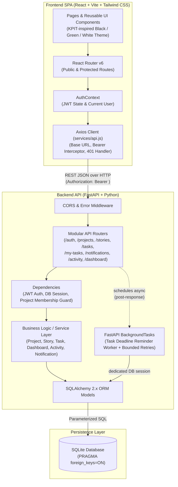
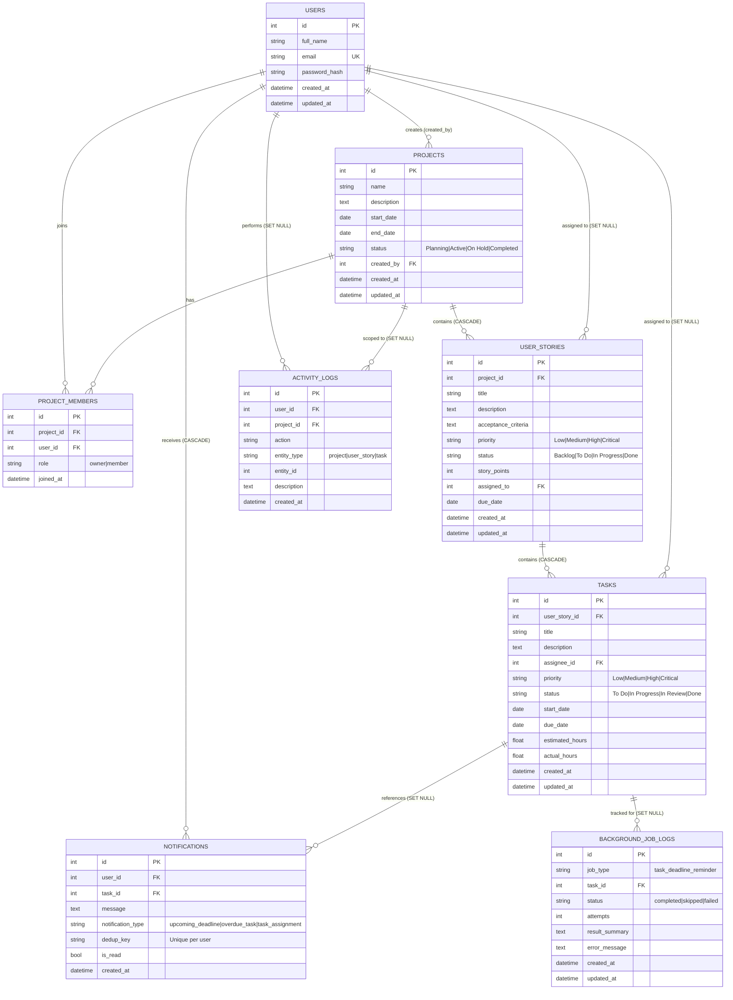
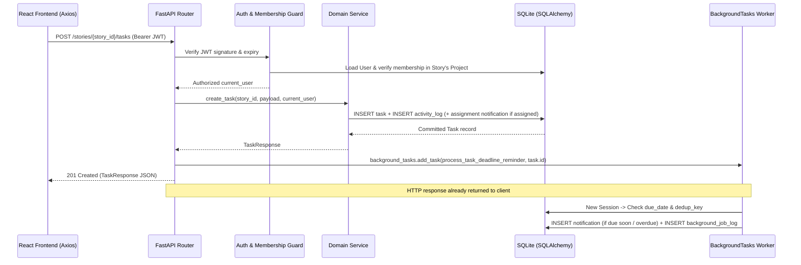
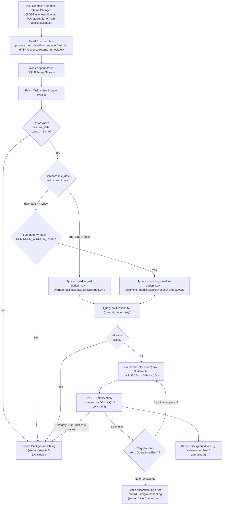

# SprintFlow — System Architecture Specification

> **Document Purpose:** Phase 1 architectural blueprint for **SprintFlow**, a full-stack Agile Project Management Tool built for small development teams (3–10 users).  
> **Core Work Hierarchy:** `Project → User Story → Task`

---

## 1. High-Level System Architecture

SprintFlow uses a clean, decoupled **Client–Server Layered Architecture** optimized for maintainability, clarity, and small-team workloads without unnecessary operational overhead.



### Key Architectural Principles
1. **Strict Separation of Concerns:** Routers handle HTTP transport & validation; Services encapsulate business rules, authorization checks, and activity logging; Models define relational persistence; Background workers run post-response side effects in isolated sessions.
2. **Database-First Source of Truth:** Zero hardcoded dashboard stats or dummy state; all metrics, progress bars, Kanban columns, notifications, and logs are computed or fetched from SQLite.
3. **Referential Integrity by Design:** SQLite foreign-key enforcement (`PRAGMA foreign_keys=ON`) is activated on every database connection via a SQLAlchemy engine event listener, ensuring cascading deletes and preventing orphaned user stories or tasks.

---

## 2. Repository & Directory Architecture

```text
SprintFlow/
├── backend/
│   ├── app/
│   │   ├── main.py                 # FastAPI app factory, CORS, exception handlers, router mounting
│   │   ├── database.py             # SQLAlchemy engine, PRAGMA foreign_keys=ON, SessionLocal, Base
│   │   ├── core/
│   │   │   ├── config.py           # Pydantic BaseSettings loading .env safely
│   │   │   ├── security.py         # bcrypt hashing, JWT create/verify
│   │   │   └── dependencies.py     # get_db, get_current_user, require_project_member
│   │   ├── models/
│   │   │   ├── __init__.py
│   │   │   ├── user.py
│   │   │   ├── project.py          # Project & ProjectMember
│   │   │   ├── user_story.py
│   │   │   ├── task.py
│   │   │   ├── notification.py
│   │   │   ├── activity_log.py
│   │   │   └── background_job_log.py
│   │   ├── schemas/
│   │   │   ├── auth.py
│   │   │   ├── project.py
│   │   │   ├── user_story.py
│   │   │   ├── task.py
│   │   │   ├── notification.py
│   │   │   ├── activity.py
│   │   │   └── dashboard.py
│   │   ├── services/
│   │   │   ├── auth_service.py
│   │   │   ├── project_service.py
│   │   │   ├── story_service.py
│   │   │   ├── task_service.py
│   │   │   ├── notification_service.py
│   │   │   ├── activity_service.py
│   │   │   └── dashboard_service.py
│   │   ├── routers/
│   │   │   ├── auth.py
│   │   │   ├── users.py
│   │   │   ├── projects.py
│   │   │   ├── stories.py
│   │   │   ├── tasks.py
│   │   │   ├── my_tasks.py
│   │   │   ├── notifications.py
│   │   │   ├── activity.py
│   │   │   └── dashboard.py
│   │   ├── background/
│   │   │   └── deadline_reminders.py  # FastAPI BackgroundTasks worker, retry & dedup logic
│   │   └── tests/
│   │       ├── conftest.py
│   │       ├── test_auth.py
│   │       ├── test_projects.py
│   │       ├── test_stories.py
│   │       ├── test_tasks.py
│   │       ├── test_database_integrity.py
│   │       ├── test_background_reminders.py
│   │       └── test_security.py
│   └── requirements.txt
├── frontend/
│   ├── index.html
│   ├── package.json
│   ├── vite.config.js
│   ├── tailwind.config.js
│   ├── postcss.config.js
│   └── src/
│       ├── main.jsx
│       ├── App.jsx
│       ├── index.css
│       ├── context/
│       │   ├── AuthContext.jsx
│       │   └── ToastContext.jsx
│       ├── services/
│       │   ├── api.js              # Centralized Axios instance & interceptors
│       │   ├── auth.js
│       │   ├── projects.js
│       │   ├── stories.js
│       │   ├── tasks.js
│       │   ├── notifications.js
│       │   ├── activity.js
│       │   └── dashboard.js
│       ├── hooks/
│       │   └── useDebounce.js
│       ├── utils/
│       │   ├── formatters.js       # Date, status, priority styling helpers
│       │   └── constants.js
│       ├── layouts/
│       │   └── AppLayout.jsx       # Black sidebar + top navbar + workspace shell
│       ├── components/
│       │   ├── common/             # Button, Card, Badge, Modal, ConfirmDialog, EmptyState, Spinner, ProgressBar
│       │   ├── projects/           # ProjectModal, MemberManager
│       │   ├── stories/            # StoryModal, StoryCard
│       │   ├── tasks/              # TaskModal, TaskDetailModal, TaskRow
│       │   └── kanban/             # KanbanColumn, KanbanCard
│       └── pages/
│           ├── Login.jsx
│           ├── Register.jsx
│           ├── Dashboard.jsx
│           ├── Projects.jsx
│           ├── ProjectDetails.jsx
│           ├── MyTasks.jsx
│           ├── KanbanBoard.jsx
│           ├── Notifications.jsx
│           ├── ActivityLog.jsx
│           └── Settings.jsx
├── docs/
│   ├── ARCHITECTURE.md
│   ├── DATABASE.md
│   ├── API_DOCUMENTATION.md
│   ├── DESIGN_DECISIONS.md
│   ├── SECURITY.md
│   ├── AI_USAGE.md
│   └── FUTURE_IMPROVEMENTS.md
├── screenshots/
├── .env.example
├── .gitignore
├── README.md
├── implementation_plan.md
└── architecture.md
```

---

## 3. Database Schema & ER Architecture

SprintFlow defines **7 core domain tables** specified in the assignment plus **1 operational audit table** (`background_job_logs`) to persistently record background reminder processing attempts and outcomes.



### Referential Integrity & Deletion Rules
- **Project Deletion (`ON DELETE CASCADE`)**: Deleting a project cascades to `project_members`, `user_stories`, and transitively to all `tasks` under those stories. No orphaned stories or tasks can exist.
- **User Story Deletion (`ON DELETE CASCADE`)**: Deleting a story cascades to all its child `tasks`.
- **Unique Constraints**:
  - `users.email` (`UNIQUE`)
  - `project_members (project_id, user_id)` (`UNIQUE`)
  - `notifications (user_id, dedup_key)` (`UNIQUE`, prevents duplicate notifications even under concurrent retries)
- **Indexes**:
  - Indexed foreign keys: `projects.created_by`, `project_members.project_id`, `project_members.user_id`, `user_stories.project_id`, `tasks.user_story_id`, `tasks.assignee_id`, `notifications.user_id`, `activity_logs.project_id`, `activity_logs.created_at`.
  - Query filter indexes: `tasks.status`, `tasks.due_date`, `notifications.is_read`.

---

## 4. API & Request Data Flow

### Standard Authenticated Request Lifecycle



### Authorization Model
1. **Authentication:** Every private route depends on `get_current_user`, which validates the `Authorization: Bearer <token>` JWT header using `SECRET_KEY` and `HS256`. Invalid or expired tokens return `401 Unauthorized`.
2. **Project Membership Authorization:**
   - Creating a project automatically adds the creator to `project_members` with `role="owner"`.
   - Viewing, updating, or deleting a project—or creating/reading/modifying any story or task inside it—requires the authenticated user to be a member of that project (`403 Forbidden` otherwise).
   - Deleting a project or managing members is restricted to project members (with owner protection so a project is never left without an owner).
   - Assigning a story or task validates that the assignee is a member of the parent project.
3. **Personal Resource Isolation:**
   - `GET /my-tasks` returns only tasks where `assignee_id == current_user.id`.
   - `GET /notifications` and `PATCH /notifications/{id}/read` strictly enforce `notification.user_id == current_user.id`.

---

## 5. Asynchronous / Background Workflow Architecture

### Task Deadline Reminder Workflow (FastAPI `BackgroundTasks`)



### Failure Handling, Idempotency & Honest Limitations
- **Isolation from Request Path:** Exceptions inside the background task are caught and logged; they **never** break or roll back the primary task API call.
- **Bounded Retries:** Transient failures (such as SQLite write lock `OperationalError`) retry up to `3` attempts with bounded backoff. Permanent errors fail fast.
- **Two-Layer Duplicate Prevention:** Application-level check on `(user_id, dedup_key)` plus a database-level `UNIQUE` constraint on `(user_id, dedup_key)` guarantee zero duplicate notifications across retries or repeated edits.
- **Known Limitation (Explicitly Acknowledged):** FastAPI `BackgroundTasks` runs **in-process** within the Uvicorn worker. It is **not** a persistent distributed job queue: if the Python process crashes or restarts while a task is queued or mid-execution, that pending reminder execution is lost. Additionally, reminders are event-triggered (on task create/update) rather than driven by a persistent wall-clock cron daemon. A production scale-up would move this to Celery/Dramatiq + Redis/RabbitMQ with a periodic scheduler (e.g., Celery Beat).

---

## 6. Frontend Architecture & Design System

### Visual Brand Identity (KPIT-Inspired Black, Green & White)
| Token | Hex | Usage |
|---|---|---|
| Primary Black | `#101010` | Sidebar background, primary headings, button text on green |
| Secondary Black | `#171717` | Elevated dark surfaces, sidebar hover states |
| Primary Green | `#75C900` | Primary CTAs, active sidebar indicator, progress bars, key accents |
| White | `#FFFFFF` | Main workspace background, cards, modals, sidebar text/icons |
| Light Grey | `#F5F5F5` | Subtle card backgrounds, table headers, input backgrounds |
| Border Grey | `#E5E5E5` | Card borders, dividers, table gridlines |
| Secondary Text | `#737373` | Metadata, timestamps, helper copy |
| Success / Warning / Error | `#16A34A` / `#F59E0B` / `#DC2626` | Status badges, due-soon alerts, overdue/destructive actions |

*(No navy-blue or purple anywhere in the palette; custom SprintFlow geometric brand mark only—no official KPIT logo or affiliation claims.)*

### Frontend State & Data Flow
- **`AuthContext`**: Holds `user`, `token`, `loading`, `login()`, `register()`, `logout()`, `refreshUser()`. Validates persisted JWT via `GET /auth/me` on app boot.
- **`ToastContext`**: Global non-blocking success/error notifications (especially important for Kanban optimistic drag-and-drop feedback and rollback).
- **`services/api.js`**: Single Axios instance configured with `VITE_API_BASE_URL` (default `http://localhost:8000`), automatically attaching `Authorization: Bearer <token>` and intercepting `401` responses to cleanly sign out expired sessions.
- **Kanban Optimistic UI**: Dragging a task card updates local column state immediately, fires `PATCH /tasks/{id}/status`, confirms with a subtle toast, and restores the prior column snapshot if the API rejects the update.
