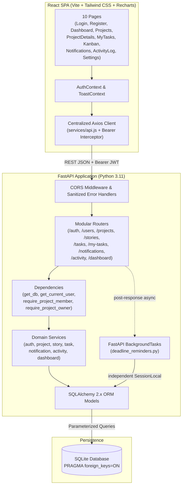
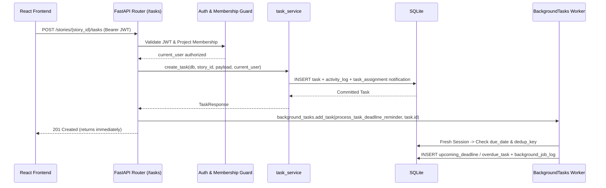

# SprintFlow — System Architecture

## 1. High-Level Architecture

SprintFlow follows a decoupled **Client–Server Layered Architecture** engineered for clarity, testability, and small-team (3–10 users) Agile collaboration.

---

## 2. Frontend Architecture

- **Framework:** React 18 + Vite 6 + Tailwind CSS 3 + React Router v6.
- **State & Auth (`src/context/`):**
  - `AuthContext` validates persisted JWTs on app boot via `GET /auth/me`, tracks live unread notification count, and responds to global `sprintflow:unauthorized` events emitted by Axios when a token expires (`401`).
  - `ToastContext` provides non-blocking success, info, and error feedback across all workflows (including Kanban rollback notices).
- **Centralized API Layer (`src/services/`):**
  - `api.js` creates one configured Axios instance reading `VITE_API_BASE_URL` (default `http://localhost:8000`) and automatically attaching `Authorization: Bearer <token>`.
  - Domain wrappers (`auth.js`, `projects.js`, `stories.js`, `tasks.js`, `notifications.js`, `dashboard.js`) keep network logic out of React components.
- **Reusable Component System (`src/components/`):**
  - Common primitives (`Button`, `Card`, `Badge`, `StatusBadge`, `PriorityBadge`, `ProgressBar`, `Modal`, `ConfirmDialog`, `EmptyState`, `LoadingSpinner`, `ErrorBanner`, form field inputs, `BrandLogo`) enforce the Black (`#101010`), Green (`#75C900`), and White (`#FFFFFF`) identity consistently.
  - Domain modals (`ProjectModal`, `StoryModal`, `TaskModal`, `TaskDetailModal`) are reused across pages to avoid duplicated form code.
- **Route Protection:** `ProtectedRoute` wraps `AppLayout`, redirecting unauthenticated visitors to `/login`.

---

## 3. Backend Architecture

The FastAPI backend separates responsibilities across five distinct packages inside `backend/app/`:

1. **`core/`:** Environment configuration (`config.py`), `bcrypt` + `PyJWT` helpers (`security.py`), and reusable FastAPI dependencies (`dependencies.py`).
2. **`models/`:** 8 SQLAlchemy 2.x ORM models defining tables, foreign keys, cascading rules, unique constraints, check constraints, and indexes.
3. **`schemas/`:** Pydantic v2 request/response models enforcing strict validation (`extra="forbid"` prevents mass-assignment tampering; `password_hash` is excluded from all outputs).
4. **`services/`:** Pure business logic (ownership checks, assignee membership validation, computed progress percentages, activity recording, dashboard aggregation).
5. **`routers/`:** Thin HTTP controllers mapping endpoints, query parameters, HTTP status codes, and scheduling `BackgroundTasks`.

---

## 4. API Communication & Data Flow

---

## 5. Asynchronous Background Processing Flow

Implemented in `backend/app/background/deadline_reminders.py`:

1. **Triggering:** Scheduled automatically on `POST /stories/{story_id}/tasks`, `PUT /tasks/{task_id}`, and `PATCH /tasks/{task_id}/status` using FastAPI's `BackgroundTasks`.
2. **Session Isolation:** The worker creates its own fresh SQLAlchemy session via `session_factory()` after the request session has closed.
3. **Evaluation:** Skips tasks that are `Done`, unassigned, or missing a `due_date`. Classifies `due_date < today` as `overdue_task` and `today <= due_date <= today + DEADLINE_REMINDER_DAYS` as `upcoming_deadline`.
4. **Two-Layer Duplicate Prevention:** Computes a deterministic `dedup_key = "{type}:task:{task_id}:user:{user_id}:due:{due_date}"`, checks for existing rows first, and relies on SQLite's `UNIQUE(user_id, dedup_key)` constraint to stop concurrent duplicate inserts cleanly.
5. **Bounded Retries & Failure Handling:** Retries transient errors (`OperationalError`, `TimeoutError`, `OSError`) up to `BACKGROUND_MAX_RETRIES` (default 3) with exponential backoff (`0.2s`, `0.4s`, ...). Non-retryable errors fail fast. All exceptions are caught and logged so background failures **never** break the primary task API response.
6. **Audit Trail:** Every run records an operational row in `background_job_logs` (`completed`, `skipped`, or `failed`, with `attempts`, `result_summary`, and `error_message`).

### Known Limitation
FastAPI `BackgroundTasks` runs **in-process** within the Uvicorn server process. It is **not** a persistent distributed job queue: if the process crashes or restarts while a reminder is pending, that queued execution is lost. Furthermore, reminders are event-triggered on task mutations rather than fired by a persistent wall-clock cron daemon. See [FUTURE_IMPROVEMENTS.md](FUTURE_IMPROVEMENTS.md) for the production upgrade path.
