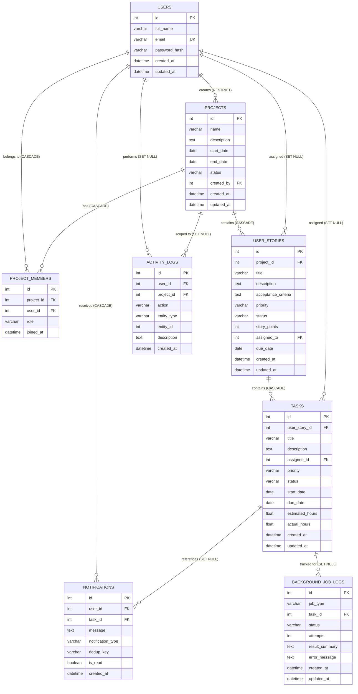

# SprintFlow — Database Schema & Relational Design

SprintFlow uses **SQLite** with **SQLAlchemy 2.x ORM**. Foreign-key enforcement (`PRAGMA foreign_keys=ON;`) is enabled automatically on every SQLite connection via an `@event.listens_for(Engine, "connect")` listener in `backend/app/database.py`.

---

## 1. Entity-Relationship Diagram

---

## 2. Table Specifications

### 1. `users`
| Column | Type | Constraints | Notes |
|---|---|---|---|
| `id` | `INTEGER` | `PRIMARY KEY` | Auto-increment user identifier |
| `full_name` | `VARCHAR(120)` | `NOT NULL` | Display name |
| `email` | `VARCHAR(255)` | `NOT NULL`, `UNIQUE`, `INDEX` | Normalized lowercase email |
| `password_hash` | `VARCHAR(255)` | `NOT NULL` | Salted bcrypt hash (never returned by API) |
| `created_at` | `DATETIME` | `NOT NULL` | UTC creation timestamp |
| `updated_at` | `DATETIME` | `NOT NULL` | UTC last-updated timestamp |

### 2. `projects`
| Column | Type | Constraints | Notes |
|---|---|---|---|
| `id` | `INTEGER` | `PRIMARY KEY` | Project identifier |
| `name` | `VARCHAR(150)` | `NOT NULL`, `INDEX` | Project title |
| `description` | `TEXT` | Nullable | Project scope overview |
| `start_date` | `DATE` | Nullable | Planned start date |
| `end_date` | `DATE` | Nullable, `INDEX` | Project deadline |
| `status` | `VARCHAR(30)` | `NOT NULL`, `INDEX`, `CHECK` | `'Planning' \| 'Active' \| 'On Hold' \| 'Completed'` |
| `created_by` | `INTEGER` | `NOT NULL`, `FK -> users.id (RESTRICT)`, `INDEX` | Original creator |
| `created_at` / `updated_at` | `DATETIME` | `NOT NULL` | UTC timestamps |

### 3. `project_members`
| Column | Type | Constraints | Notes |
|---|---|---|---|
| `id` | `INTEGER` | `PRIMARY KEY` | Membership identifier |
| `project_id` | `INTEGER` | `NOT NULL`, `FK -> projects.id (CASCADE)`, `INDEX` | Parent project |
| `user_id` | `INTEGER` | `NOT NULL`, `FK -> users.id (CASCADE)`, `INDEX` | Member user |
| `role` | `VARCHAR(20)` | `NOT NULL`, `CHECK` | `'owner' \| 'member'` |
| `joined_at` | `DATETIME` | `NOT NULL` | UTC join timestamp |
| **Unique** | — | `UNIQUE (project_id, user_id)` | Prevents duplicate membership |

### 4. `user_stories`
| Column | Type | Constraints | Notes |
|---|---|---|---|
| `id` | `INTEGER` | `PRIMARY KEY` | Story identifier |
| `project_id` | `INTEGER` | `NOT NULL`, `FK -> projects.id (CASCADE)`, `INDEX` | Parent project (prevents orphans) |
| `title` | `VARCHAR(200)` | `NOT NULL`, `INDEX` | Story title |
| `description` | `TEXT` | Nullable | Story detail |
| `acceptance_criteria` | `TEXT` | Nullable | Definition of Done |
| `priority` | `VARCHAR(20)` | `NOT NULL`, `INDEX`, `CHECK` | `'Low' \| 'Medium' \| 'High' \| 'Critical'` |
| `status` | `VARCHAR(20)` | `NOT NULL`, `INDEX`, `CHECK` | `'Backlog' \| 'To Do' \| 'In Progress' \| 'Done'` |
| `story_points` | `INTEGER` | Nullable, `CHECK (>= 0)` | Agile estimation points |
| `assigned_to` | `INTEGER` | Nullable, `FK -> users.id (SET NULL)`, `INDEX` | Story owner |
| `due_date` | `DATE` | Nullable, `INDEX` | Target completion date |
| `created_at` / `updated_at` | `DATETIME` | `NOT NULL` | UTC timestamps |
| **Composite Index** | — | `ix_user_stories_project_status (project_id, status)` | Fast filtered story queries |

### 5. `tasks`
| Column | Type | Constraints | Notes |
|---|---|---|---|
| `id` | `INTEGER` | `PRIMARY KEY` | Task identifier |
| `user_story_id` | `INTEGER` | `NOT NULL`, `FK -> user_stories.id (CASCADE)`, `INDEX` | Parent story (prevents orphans) |
| `title` | `VARCHAR(200)` | `NOT NULL`, `INDEX` | Task title |
| `description` | `TEXT` | Nullable | Task notes |
| `assignee_id` | `INTEGER` | Nullable, `FK -> users.id (SET NULL)`, `INDEX` | Assigned team member |
| `priority` | `VARCHAR(20)` | `NOT NULL`, `INDEX`, `CHECK` | `'Low' \| 'Medium' \| 'High' \| 'Critical'` |
| `status` | `VARCHAR(20)` | `NOT NULL`, `INDEX`, `CHECK` | `'To Do' \| 'In Progress' \| 'In Review' \| 'Done'` |
| `start_date` / `due_date` | `DATE` | Nullable (`due_date` indexed) | Schedule & deadline tracking |
| `estimated_hours` / `actual_hours` | `FLOAT` | Nullable, `CHECK (>= 0)` | Effort tracking |
| `created_at` / `updated_at` | `DATETIME` | `NOT NULL` | UTC timestamps |
| **Composite Indexes** | — | `(user_story_id, status)`, `(assignee_id, status)` | Fast Kanban & My Tasks queries |

### 6. `notifications`
| Column | Type | Constraints | Notes |
|---|---|---|---|
| `id` | `INTEGER` | `PRIMARY KEY` | Notification identifier |
| `user_id` | `INTEGER` | `NOT NULL`, `FK -> users.id (CASCADE)`, `INDEX` | Recipient user |
| `task_id` | `INTEGER` | Nullable, `FK -> tasks.id (SET NULL)`, `INDEX` | Related task |
| `message` | `TEXT` | `NOT NULL` | Human-readable alert message |
| `notification_type` | `VARCHAR(30)` | `NOT NULL`, `INDEX`, `CHECK` | `'upcoming_deadline' \| 'overdue_task' \| 'task_assignment'` |
| `dedup_key` | `VARCHAR(255)` | `NOT NULL` | Deterministic idempotency key |
| `is_read` | `BOOLEAN` | `NOT NULL`, `DEFAULT 0`, `INDEX` | Read status |
| `created_at` | `DATETIME` | `NOT NULL`, `INDEX` | UTC creation timestamp |
| **Unique & Index** | — | `UNIQUE (user_id, dedup_key)`, `INDEX (user_id, is_read)` | Guarantees zero duplicate reminders |

### 7. `activity_logs`
| Column | Type | Constraints | Notes |
|---|---|---|---|
| `id` | `INTEGER` | `PRIMARY KEY` | Activity entry identifier |
| `user_id` | `INTEGER` | Nullable, `FK -> users.id (SET NULL)`, `INDEX` | Acting user |
| `project_id` | `INTEGER` | Nullable, `FK -> projects.id (SET NULL)`, `INDEX` | Project scope |
| `action` | `VARCHAR(50)` | `NOT NULL`, `INDEX` | e.g., `project_created`, `task_completed` |
| `entity_type` | `VARCHAR(30)` | `NOT NULL`, `INDEX`, `CHECK` | `'project' \| 'user_story' \| 'task'` |
| `entity_id` | `INTEGER` | `NOT NULL`, `INDEX` | Affected entity PK |
| `description` | `TEXT` | `NOT NULL` | Human-readable event description |
| `created_at` | `DATETIME` | `NOT NULL`, `INDEX` | UTC event timestamp |

### 8. `background_job_logs` *(Operational Audit Table)*
| Column | Type | Constraints | Notes |
|---|---|---|---|
| `id` | `INTEGER` | `PRIMARY KEY` | Job execution record ID |
| `job_type` | `VARCHAR(50)` | `NOT NULL`, `INDEX` | `'task_deadline_reminder'` |
| `task_id` | `INTEGER` | Nullable, `FK -> tasks.id (SET NULL)`, `INDEX` | Target task |
| `status` | `VARCHAR(20)` | `NOT NULL`, `INDEX`, `CHECK` | `'completed' \| 'skipped' \| 'failed'` |
| `attempts` | `INTEGER` | `NOT NULL`, `CHECK (>= 0)` | Number of attempts executed |
| `result_summary` | `TEXT` | Nullable | Concise run outcome |
| `error_message` | `TEXT` | Nullable | Sanitized error info on failure |
| `created_at` / `updated_at` | `DATETIME` | `NOT NULL` | UTC timestamps |

---

## 3. Referential Integrity & Cascading Strategy

- **No Orphaned Records:** `user_stories.project_id` and `tasks.user_story_id` are `NOT NULL` foreign keys enforced by SQLite (`PRAGMA foreign_keys=ON`).
- **Cascade Hierarchy:** Deleting a `Project` cascades cleanly to `project_members`, `user_stories`, and transitively `tasks`. Deleting a `UserStory` cascades cleanly to its child `tasks`.
- **Audit Preservation:** Deleting a project or task sets `activity_logs.project_id`, `notifications.task_id`, and `background_job_logs.task_id` to `NULL` (`ON DELETE SET NULL`) so historical logs and user notifications are preserved without integrity errors.
