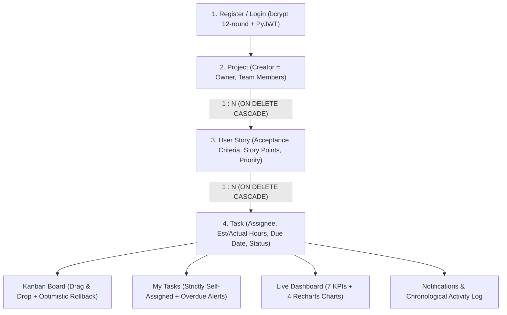
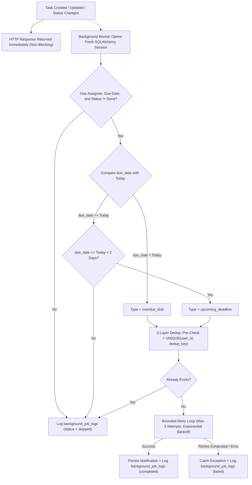

# SprintFlow — System & Workflow Flowcharts

> Visual flowcharts rendered natively on GitHub covering SprintFlow's full-stack architecture, hierarchical Agile workflow (`Project → User Story → Task`), and asynchronous FastAPI `BackgroundTasks` reminder pipeline.

---

## 1. Full-Stack System Architecture Flow

```mermaid
flowchart LR
    FE["React + Vite SPA (10 Pages, Tailwind, Recharts)"]
    AX["Axios Client (Bearer JWT + 401 Handler)"]
    API["FastAPI Routers (34 Routes + Swagger /docs)"]
    GUARD["Auth & Membership Guard (PyJWT + Owner/Member 401/403)"]
    SVC["Domain Services (CRUD, Progress, Activity Log)"]
    BG["FastAPI BackgroundTasks (Post-Response Worker)"]
    DB[("SQLite + SQLAlchemy 2.x (PRAGMA foreign_keys=ON, 8 Tables)")]

    FE -->|"REST JSON"| AX
    AX -->|"Authorization: Bearer JWT"| API
    API --> GUARD
    GUARD --> SVC
    SVC -->|"Parameterized ORM"| DB
    SVC -.->|"Schedule async"| BG
    BG -.->|"Fresh DB Session"| DB
```

---

## 2. Hierarchical Work Tracking Flow (`Project → User Story → Task`)

---

## 3. Asynchronous Background Reminder Pipeline (`FastAPI BackgroundTasks`)

> **Architectural Tradeoff:** FastAPI `BackgroundTasks` runs in-process after the HTTP response; queued reminders do not survive server restarts. For production scale, migrate to **Celery / Dramatiq + Redis** with a periodic scheduler (see [FUTURE_IMPROVEMENTS.md](FUTURE_IMPROVEMENTS.md)).
