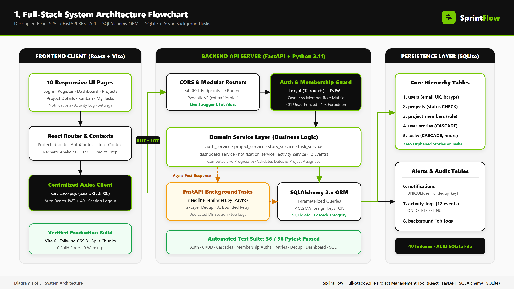
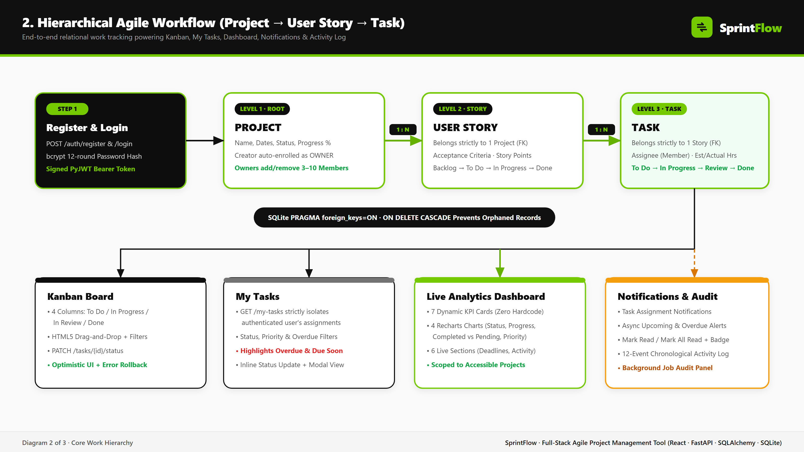
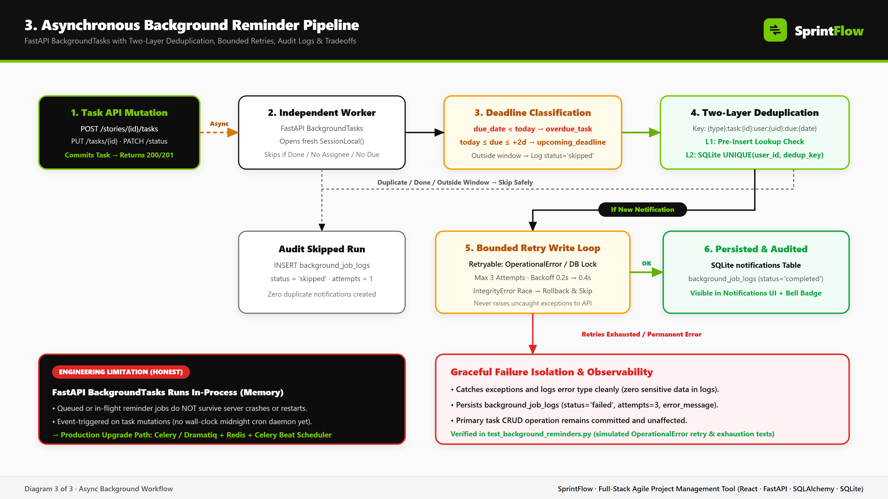

# SprintFlow — System & Workflow Flowcharts

> High-resolution architecture, Agile work hierarchy (`Project → User Story → Task`), and asynchronous `FastAPI BackgroundTasks` flowcharts for SprintFlow.

---

## 1. Full-Stack System Architecture Flowchart

---

## 2. Hierarchical Agile Workflow (`Project → User Story → Task`)

---

## 3. Asynchronous Background Reminder Pipeline (`FastAPI BackgroundTasks`)

> **Architectural Tradeoff:** FastAPI `BackgroundTasks` runs in-process after the HTTP response; queued reminders do not survive server restarts. For production scale, migrate to **Celery / Dramatiq + Redis** with a periodic scheduler (see [FUTURE_IMPROVEMENTS.md](FUTURE_IMPROVEMENTS.md)).
